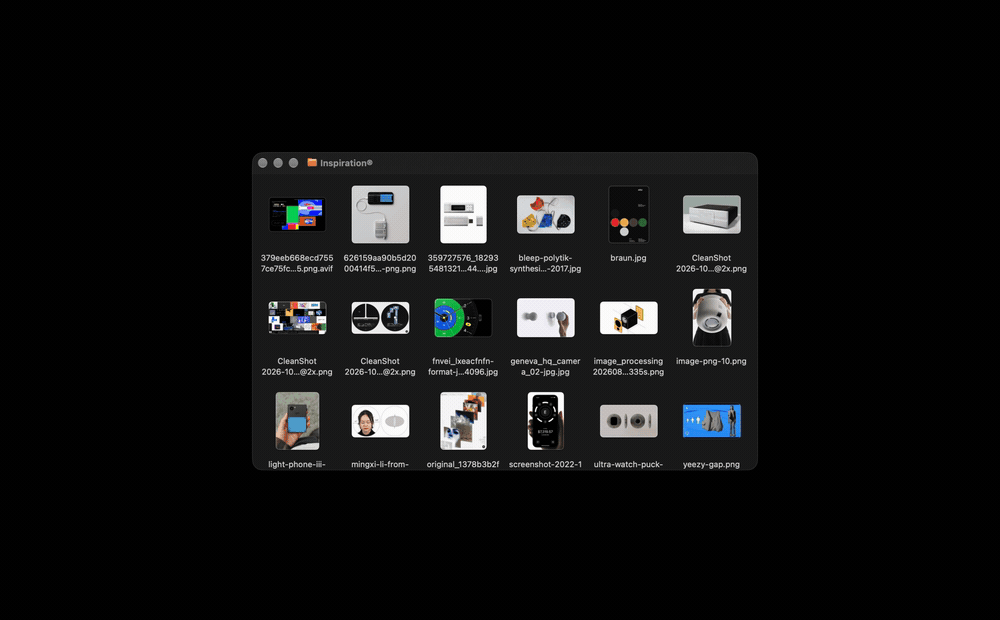

# Figma x Finder

Figma x Finder is a macOS Finder service that sends images straight to a saved page or frame in Figma.

Useful when you're collecting references, building a moodboard, or bringing inspiration into a design file. Save a destination once, then send new selections from Finder whenever you need them.



## Getting started

### Installation

1. Clone the project and run the installer

   ```sh
   git clone https://github.com/behlock/figma-x-finder.git
   cd figma-x-finder
   bash scripts/install.sh
   ```

   This builds a release app, installs it in `~/Applications`, and registers **Send to Figma** with Finder.

2. Open the app

   ```sh
   open "$HOME/Applications/Figma x Finder.app"
   ```

### Set up the Figma receiver

1. In Figma Desktop, choose **Plugins → Development → Import plugin from manifest**
2. Select the installed app's receiver manifest:

   ```text
   ~/Applications/Figma x Finder.app/Contents/Resources/receiver/manifest.json
   ```

3. Open a saved Figma Design file and run **Plugins → Development → Figma x Finder**
4. Click **Connect to Mac** in the receiver, then approve the matching code in the Mac app
5. Select a frame, or clear the selection to use the current page. Give the destination a name and save it

Keep the receiver open in the destination file while sending images from Finder.

## Usage

### Send images

1. Select up to **100 images** in Finder
2. Right-click and choose **Services → Send to Figma**. Depending on your Finder menu, the service may appear directly in the context menu
3. Choose a saved destination and send

Images keep their proportions and are placed around existing content. Frames grow when they need more room, and Auto Layout frames use their existing layout.

### Supported images

The service supports image formats that macOS Image I/O can read, including PNG, JPEG, HEIC, TIFF, GIF, and WebP. Available formats depend on your macOS version.

Large images are resized to at most **4,096 pixels on the longest edge**, with a **10 MB limit per prepared image**. Transparency is preserved in PNG copies. Animated images are imported as their first frame.

## Troubleshooting

- **The Finder service is missing:** open the Mac app once and check that **Send to Figma** is enabled in macOS Services settings. Re-run `bash scripts/install.sh` to register it again
- **The plugin says to open the Mac app:** launch **Figma x Finder** from your Applications folder
- **Images are waiting:** make sure the receiver is running in the file that contains your saved destination
- **A saved destination was deleted:** save a new page or frame before sending another batch
- **After updating:** close and rerun the receiver plugin in Figma to load the new code
